<h1 align="center">
  
</h1>

<h3 align="center">SEO audits that prove every finding, then fix it in your code.</h3>

<p align="center">
  Google and Yandex · reports in English and Russian · built on <a href="https://claude.com/product/claude-code">Claude Code</a>
</p>

<p align="center">
  
  
  
  
  
  
</p>

<p align="center">
  <a href="#why-it-is-different">Why it is different</a> ·
  <a href="#proven-on-real-sites">Real sites</a> ·
  <a href="#what-you-can-order"><b>Services</b></a> ·
  <a href="#contact"><b>Contact</b></a> ·
  <a href="README.ru.md">Русский</a>
</p>

<p align="center">
  <a href="../../issues/new?template=order.yml"></a>
  <a href="https://t.me/fahrad_l"></a>
  <a href="mailto:levonyanfahrad@gmail.com?subject=Searchwright%20audit"></a>
  <a href="https://www.linkedin.com/in/levonyanfahrad"></a>
</p>

> [!NOTE]
> **This is a showcase. The source code is private.** You can order an audit,
> fixes in your code, monitoring or access for your team: see
> [What you can order](#what-you-can-order).

## Why it is different

Most SEO reports tell you *that* something is wrong. Searchwright shows
*where*, *why* and *how to check* it, and then fixes it.

<table>
  <tr>
    <td width="33%" valign="top">
      <h3>🔎 Evidence for every finding</h3>
      Each finding lists the addresses it was found on, a quote from the page
      and the check that confirms the fix. No guesswork, nothing to take on
      faith.
    </td>
    <td width="33%" valign="top">
      <h3>🛠 Fixes, not only reports</h3>
      Findings become edits in your code on a separate branch. A finding is
      closed only when its check, run again, no longer reports it.
    </td>
    <td width="33%" valign="top">
      <h3>📏 Same site, same score</h3>
      The score is computed by code, not guessed by a model. The same site
      gives the same findings and the same number on every run.
    </td>
  </tr>
</table>

<p align="center">
  
</p>

| | An audit that only asks an AI | Searchwright |
|---|---|---|
| **What it reads** | A few pages it was shown | The whole site, crawled by code: up to 50,000 addresses per run, with a real browser for pages built by JavaScript |
| **Score** | Can change from run to run | Computed by code, repeatable |
| **Proof** | "Some pages have a canonical problem" | The addresses, the quoted tag, the redirect chain |
| **Result** | A document for your developer | Edits on a branch, each one confirmed by a re-check |
| **Search engines** | Usually Google only | Google and Yandex, with the rules of both |

## What a finding looks like

An illustrative example on a made-up site:

```text
HIGH   Canonical points to a page that redirects back             18 pages

page       https://example.com/catalog/shoes?page=2
evidence   <link rel="canonical" href="https://example.com/catalog/shoes">
           /catalog/shoes  ->  script redirect  ->  /catalog/shoes?page=2
why        Two signals contradict each other, so search engines pick the
           main page themselves
fix        Point the canonical at the page itself, or remove the redirect
re-check   runs again after the fix; the finding closes only when it is gone
```

## In numbers

<table>
  <tr>
    <td align="center" width="33%"><h2>101 / 101</h2>planted defects found on the test site</td>
    <td align="center" width="33%"><h2>0</h2>false findings, 26 clean pages included</td>
    <td align="center" width="33%"><h2>1.8 s</h2>500 pages from crawl to HTML report</td>
  </tr>
  <tr>
    <td align="center"><h2>37 + 20</h2>skills and specialist agents</td>
    <td align="center"><h2>0</h2>API keys needed for the core audit</td>
    <td align="center"><h2>5,000+</h2>automated tests on every change</td>
  </tr>
</table>

## What it checks

| Area | What is inside |
|---|---|
| ⚙️ **Technical SEO** | Crawling and indexing, redirects, canonicals, robots.txt by the rules of Google *and* Yandex, sitemaps, hreflang, security headers, content that appears only after JavaScript |
| ✍️ **Content** | E-E-A-T, thin and duplicate pages, Russian text by lemmas (word forms, filler, officialese, typography, readability), content briefs |
| 🧩 **Markup** | Schema.org: detection, validation, generation; product markup for stores |
| ⚡ **Speed** | Core Web Vitals measured in a lab browser with no key; PageSpeed and CrUX data with a key |
| 📊 **Search data** | Google Search Console and GA4, Yandex Webmaster and Metrica; a work list from real queries: positions 5 to 20, weak CTR, two pages competing for one query, pages losing clicks |
| 🤖 **AI search** | Visibility in AI answers (GEO), AI crawler access, readiness for AI agents |
| 📍 **Local SEO** | Google Business Profile, Yandex Business, 2GIS, name, address and phone across the site, reviews |
| 🛒 **E-commerce** | Product pages, YML feeds for Yandex Products, marketplace data |
| 🔗 **Links** | Internal page weight, orphan pages, click depth, link text, links worth adding; backlink profile |
| 🧰 **Operations** | Server logs (real and fake search bots), site migrations with a redirect map, monitoring that flags what got worse after a release |
| ⚖️ **Russian law** | Personal data forms (policy and consent), ad labelling (erid), analytics counters |

Reports come as an HTML page, PDF, Excel, CSV or an interactive page to
search and filter, in English or Russian. For agencies the reports are
**white-label**: your name, logo and colours.

## Proven on real sites

Live runs of 26 and 27 November 2026:

- **A large Next.js site behind Cloudflare** (about 50,000 company pages, 500
  addresses per run). Found a canonical that loops through a script redirect
  on 134 pages, page metadata pushed into `<body>` on 107 pages, and content and
  links that appear only after JavaScript on 484 pages. Two runs in a row gave
  the same score and the same findings.
- **Cross-checked with Screaming Frog** (free, 25.2.0) on the same 500
  addresses: the same 87 pages with metadata after `</head>`, the same 150 long
  descriptions, the same 15 addresses with parameters. In its standard crawl
  mode Screaming Frog reached 235 addresses and none of the company pages,
  which that site links only through scripts. Searchwright follows them.
- **A React (Vite) site, audit and fix.** The fix command edited the code on
  its own branch and the re-check on the dev server confirmed 2 of 2 findings
  fixed.
- **A large Russian IT media site**: 135 pages with the 10-second pause its
  robots.txt asks for, report in Russian.

## Measured on a test site

<p align="center">
  
</p>

The test site was written together with the checks. The numbers show that every
check finds what it was built to find; they do not compare Searchwright with
other tools. Measured on 2026-11-19 on an Apple M1 Pro.

## What you can order

| | Service | What you get |
|:-:|---|---|
| 🔍 | **Site audit** | A report in English or Russian where every finding has addresses and evidence, sorted by what to fix first |
| 🛠 | **Audit and fixes** | Edits in your repository on a separate branch or as a pull request, each finding confirmed by a re-check. Next.js, Nuxt, SvelteKit, Astro, React (Vite), Hugo, Jekyll, WordPress and static HTML. Server settings and copy changes come as clear instructions |
| 📈 | **Monitoring** | Scheduled audits that list what got better and what got worse after each release, with an alert on a regression |
| 🏢 | **For agencies and teams** | White-label reports for your clients, or private access to the tool itself |

Prices depend on the size of the site and the scope. Send a link and you get
an estimate.

### How it works

1. **You send a link** and say what worries you: traffic dropped, a redesign
   is coming, Yandex ignores the site.
2. **Audit.** You get the report: what is wrong, on which pages, why it
   matters and what to fix first.
3. **Fixes.** If you want, the fixes come as a branch or a pull request in your
   repository.
4. **Re-check.** A second audit confirms every fix and shows the new score.

## Contact

<p align="center">
  <a href="https://t.me/fahrad_l"></a>
</p>

<p align="center">
  <a href="../../issues/new?template=order.yml"></a>
  <a href="https://t.me/fahrad_l"></a>
  <a href="mailto:levonyanfahrad@gmail.com?subject=Searchwright%20audit"></a>
  <a href="https://www.linkedin.com/in/levonyanfahrad"></a>
</p>

The fastest way is Telegram [@fahrad_l](https://t.me/fahrad_l) or email
[levonyanfahrad@gmail.com](mailto:levonyanfahrad@gmail.com?subject=Searchwright%20audit).
Write the site address and what you need. Answers in English or Russian.

The [request form](../../issues/new?template=order.yml) on GitHub works too,
but issues here are public: for a site you do not want to name in public, use
Telegram or email.

## Access and rights

Searchwright is not distributed from this repository. The text and images here
may not be reused without written permission, see [LICENSE](LICENSE).
