<h1 align="center">
  
</h1>

<a href="README.md">English</a> · <b>Русский</b>

> **Это витрина проекта. Исходный код закрыт** и здесь не опубликован.
> Нужна демонстрация или доступ: [создайте issue](../../issues).

SEO-аудит для [Claude Code](https://claude.com/product/claude-code), который
показывает доказательства. 37 скиллов и 20 агентов: техническое SEO, качество
текстов (E-E-A-T), микроразметка, карты сайта, изображения, Core Web Vitals,
локальное SEO, ссылки, ИИ-поиск (GEO), интернет-магазины, hreflang, поисковый
опыт, кластеризация запросов, мониторинг изменений, Яндекс Вебмастер. Ещё 9
расширений по желанию добавляют данные сторонних сервисов.

  

## Что умеет

- **Код измеряет, модель объясняет.** Оценку считает код, поэтому один и тот же
  сайт при каждом запуске даёт те же находки и то же число. У каждой находки есть
  адреса, цитата со страницы и способ проверить исправление.
- **Исправляет, а не только сообщает.** Находки превращаются в правки в отдельной
  ветке, и находка закрыта, только когда проверка её больше не видит.
- **Работает без модели.** Обход, оценка и отчёт не требуют обращения к модели и
  API-ключей. Подходит для CI и запуска по расписанию.
- **Google и Яндекс.** robots.txt по правилам обеих систем, Search Console, Яндекс
  Вебмастер и Метрика, точки роста по настоящим поисковым запросам.
- **Русский язык.** Разбор текстов по леммам, отчёты на русском или английском.
- **Безопасен на чужих страницах.** Каждая загрузка защищена от SSRF и подмены
  DNS.
- **Проверен как программа.** Больше 5000 тестов.

## Измерено на тестовом сайте

  

Тестовый сайт написан вместе с проверками. Числа показывают, что каждая проверка
находит то, ради чего написана; с другими инструментами Searchwright они не
сравнивают. Измерено 19.11.2026 на Apple M1 Pro.

## Доступ и права

Searchwright не распространяется из этого репозитория. Тексты и изображения
отсюда нельзя использовать без письменного разрешения, см. [LICENSE](LICENSE).
